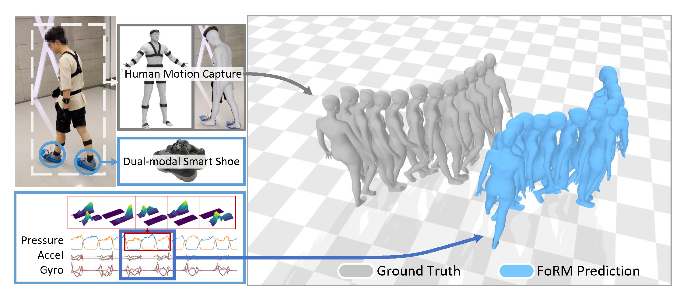

<div align="center">
<h1>FoRM: Foot-driven Reconstruction of Human Motion Using Dual-Modal Plantar Pressure and Inertial Sensing</h1>

<a href="https://doi.org/10.1145/3749551" target="_blank" rel="noopener noreferrer">
  
</a>
<a href="https://pytorch.org/get-started/locally/"></a>

**[University of Science and Technology of China](https://www.ustc.edu.cn/)**, **[Precise Pervasive Lab (PPLab)](https://pplab.ustc.edu.cn/main.htm)**

[Qijun Ying](https://gaigey.github.io/), [Zehua Cao](https://scholar.google.com/citations?user=jU6kdSIAAAAJ&hl=en), [Ziyu Wu](http://home.ustc.edu.cn/~wzy1999/), Wenwu Deng, Yuchen Zhong, Yukun Diao, [Xiaohui Cai](https://scholar.google.com/citations?user=uypjEiYAAAAJ&hl)*


</div>

```bibtex
@article{ying2025form,
  title={FoRM: Foot-driven Reconstruction of Human Motion Using Dual-Modal Plantar Pressure and Inertial Sensing},
  author={Qijun Ying, Zehua Cao, Ziyu Wu, Wenwu Deng, Yuchen Zhong, Yukun Diao, Xiaohui Cai},
  journal={Proceedings of the ACM on Interactive, Mobile, Wearable and Ubiquitous Technologies (IMWUT)},
  year={2025}
}
```

## News
- [2025.09.12] We have released the HAMPI dataset and FoRMNet checkpoints.
- [2025.09.01] Our paper has been published in **IMWUT 2025**!

## Installation

### 1. Python Environment Setup
Prepare your Python (>=3.8) environment and install the required Python packages using pip:
```bash
pip install -r requirements.txt
```

Key dependencies include:
- `PyTorch (>=1.10.0)` for model training/inference
- `joblib` for data loading utilities

### 2. SMPL Model Setup
Download the SMPL neutral model from [here](https://smpl.is.tue.mpg.de/download.php) (select "Download version 1.1.0 for Python 2.7 (female/male/neutral, 300 shape PCs)" and use the file `basicmodel_neutral_lbs_10_207_0_v1.1.0.pkl`). Place it in the following directory:
```bash
$workspace/assets/smplx_models/smpl/SMPL_NEUTRAL.pkl
```

### 3. Model Checkpoint Setup
Download the pre-trained model checkpoint (FoRM.pth) from [this link](https://huggingface.co/Qujeen/FoRM/blob/main/FoRM.pth) and place it in the following directory:
```bash
$workspace/FoRM/checkpoint/FoRM.pth
```
Download from [Hugging Face](https://huggingface.co/Qujeen/FoRM), or use `hf download Qujeen/FoRM FoRM.pth --local-dir checkpoint`.

## Project Structure

The project directory structure is organized as follows:
```
FoRM/
├── assets/                # Contains SMPL models and other static resources
│   └── smplx_models/
│       └── smpl/         # SMPL model files (e.g., SMPL_NEUTRAL.pkl)
├── checkpoint/            # Pre-trained model checkpoints (e.g., FoRM.pth)
│   └── FoRM.pth
├── data/                  # Dataset files and preprocessed data
│   └── HAMPI/
│       ├── S01/
│       └── S../
├── lib/                   # Core library code and utilities
└── eval.py
```

## HAMPI Dataset

The HAMPI dataset consists of synchronized plantar pressure and inertial measurements with corresponding motion capture data.

Dataset specifications:

- Contains data from 18 subjects (aged 21-69) performing 18 types of daily activities
- Each sample includes:
  - Dual-modal smart shoes measurement with plantar pressure and dual IMUs per foot (60Hz)
  - SMPL pose parameters (60Hz)
  - Noitom motion capture refined output (60Hz)

The HAMPI dataset is released under the [HAMPI Dataset License Agreement](https://huggingface.co/datasets/Qujeen/HAMPI/blob/main/LICENSE.txt): academic and non-commercial use only, with citation required. Redistribution, republication, or mirroring requires prior written permission from the authors. Attempts to identify participants are prohibited.
See the dataset license for full terms. The MIT license in this code repository applies to the code; it does not replace the dataset license.

You can download HAMPI dataset via the following links:
- [Hugging Face: HAMPI dataset](https://huggingface.co/datasets/Qujeen/HAMPI)

Download all release files with `hf download Qujeen/HAMPI --repo-type dataset --local-dir data/HAMPI`. The release includes subject archives S01.rar through S18.rar and a separate HAMPI test set.rar archive. Extract the required archives before evaluation.
> Contact us please if you are getting in trouble with downloading the dataset.
> 
> We are also planning to introduce a mature toolkit from AutoDesk to solve the elbow failure cases.

<!-- ## Training -->

## Evaluation

To reproduce paper results:

```
python eval.py
```

Note: Reported metrics may vary slightly (±0.1%) due to:

- Hardware differences in floating-point computation
- Random seed initialization in probabilistic components
- Minor version differences in dependency libraries

## Demo
To use our approach with your data, you can use our demo script.

First, please prepare your data with normalized forces_4x2, imu acc and imu gyro.
Then run the following demo script:
```bash
python demo.py --input /path/to/input_data.pth --output /path/to/output_result.pth
```

We can obtain the inferred SMPL human motion sequence now.

## TODO

- [x] Evaluation scripts release
- [x] HAMPI Dataset release
- [x] Checkpoints and assets release
- [x] Inference demo script release
- [ ] Training scripts release

## Acknowledgments
Partial code is adapted from [PIP](https://github.com/Xinyu-Yi/PIP), [WHAM](https://github.com/yohanshin/WHAM), and [GroundLink](https://github.com/hanxingjian/GroundLink).

## License

This repository is released under the MIT License.

## Contact

Please contact [Qijun Ying](yqj@mail.ustc.edu.cn) for any questions related to this work.

